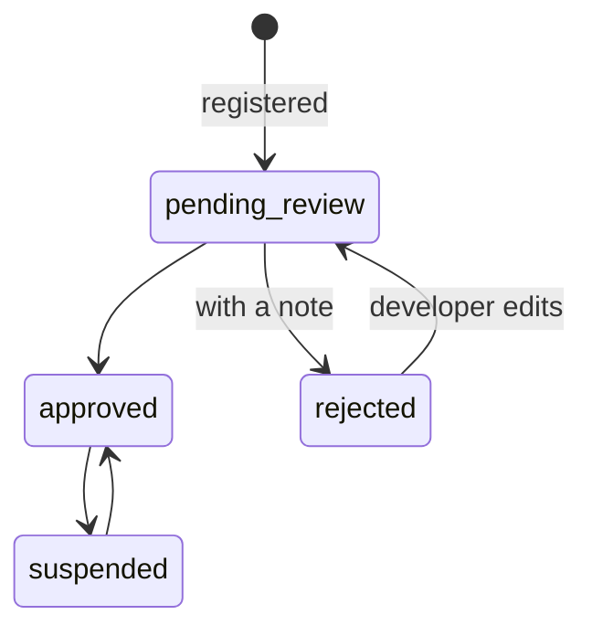

# Applications, keys and webhooks
{: .no_toc }

How an app plugs into the platform.
{: .fs-6 .fw-300 }

| Thing | What it is | Where in the Hub |
|---|---|---|
| **Application** | An app in the Substratal catalog. Has an owner (a person or an organization), a review status, its own permissions and roles, and a settings schema. | Developer → Applications |
| **Tenant** | Where an app's data lives. Shared by default; dedicated infrastructure on request. | Developer → Tenant |
| **API key** | A credential for code (a backend, a script, an AI agent) to call the Platform API. Scoped to one app or the whole platform, live or test, with only the permissions it needs. | Developer → API Keys |
| **Webhook** | A URL the platform calls when something happens (`access.revoked`, `role.removed`, `user.updated`…), signed so the app can trust it. | Developer → Webhooks |
| **Push credentials** | An app's APNs, FCM or Web Push keys, so the platform can send its notifications. | Applications → Push |

## The review lifecycle

Only **approved** apps appear in the catalog and can be given to people.

## People vs. code

People sign in to the Hub with their own account. Code uses API keys. An API key can never create or change API keys, so a leaked key can't make more of itself. Every change made with a key is recorded in the audit log under that key.
